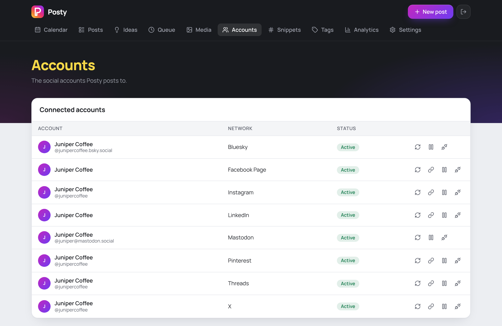

# Posty

Write a post once and publish it to Facebook Pages, Instagram, Threads, X,
LinkedIn, Pinterest, YouTube, TikTok, DeviantArt, Bluesky and Mastodon. Posty
is a self-hosted scheduler in the spirit of Buffer and Mixpost. It runs in
Docker and is reachable only from your own Tailscale network.


## Highlights

### Scheduling

- **Calendar**: month and week views. Drag a post to move it, or click a day
  to write a post for it. Tags color-code each post.
- **Queue**: set weekly time slots once, then click *Add to queue* and Posty
  picks the next free one.
- **Post now, schedule or save a draft**, then find everything under
  Scheduled, Drafts, Published and Failed.


### Posting

- **One post, many accounts**, with a live preview and character counter for
  each network.
- **Tailor each account**: different text or media per account, threads on
  X, Threads, Bluesky and Mastodon, and a first comment.
- **Network options**: Instagram feed, reel or story; Pinterest board;
  YouTube title and visibility; and more.
- **Media checked before it goes out**: image counts, file types and
  Instagram aspect ratios, with alt text and a media library.
- **Safe failures**: Posty never re-posts blindly. A failed post waits for
  you to click Retry, and can ping Slack or Discord.
- **Ideas board**: keep rough text and images in columns, then turn one into
  a post when it's ready.
- **Workspaces**: run several companies from one install. Each gets its own
  accounts, posts, ideas, media, tags, snippets and queue, with a switcher in
  the header. Add them in **Settings**.
- **Post from Claude**: Claude Code can upload images, write and schedule
  posts and manage your ideas over MCP, even from your phone. See
  [Use from Claude](#use-from-claude-mcp).

### Easy setup

- **One command**: `docker compose up -d`. Postgres is the only dependency,
  with no Redis and no open ports.
- **A guide for every network**, step by step with screenshots. Bluesky and
  Mastodon need no developer app at all.
- **Tokens stay fresh**: the worker renews them in the background. Only
  LinkedIn asks you to reconnect, every 60 days.



## Quick start

You need a machine with Docker and a free [Tailscale](https://tailscale.com)
account.

> **Just trying it out?** Skip Tailscale. Run `cp .env.example .env`, set
> `APP_URL=http://localhost:3000`, `APP_KEY`, `ADMIN_EMAIL` and
> `ADMIN_PASSWORD`, then run
> `docker compose -f compose.local.yml up -d --build` and open
> <http://localhost:3000>. Instagram, Threads and Facebook video won't work
> there.

### 1. Prepare Tailscale

In the [Tailscale admin console](https://login.tailscale.com/admin):

1. On the **DNS** page, turn on **MagicDNS** and **HTTPS Certificates**.
2. In **Access controls**, add the tag to your policy file:

   ```json
   "tagOwners": { "tag:posty": ["autogroup:admin"] }
   ```

3. Under **Settings → Keys**, click **Generate auth key**. Make it
   **reusable**, add the tag `tag:posty`, and copy the key.

### 2. Configure

```bash
git clone https://github.com/xcollantes/posty.git && cd posty
cp .env.example .env
openssl rand -base64 48   # paste the output as APP_KEY
```

Fill in these values in `.env`:

| Setting             | Value                                 |
|---------------------|---------------------------------------|
| `APP_URL`           | `https://posty.<your-tailnet>.ts.net` |
| `APP_KEY`           | the random string from above          |
| `ADMIN_EMAIL`       | your email, used to sign in           |
| `ADMIN_PASSWORD`    | a strong password                     |
| `POSTGRES_PASSWORD` | any random string                     |
| `TS_AUTHKEY`        | the key from step 1                   |

Your tailnet name is on the DNS page of the admin console, for example
`tail1234.ts.net`. The `posty` part comes from `TS_HOSTNAME`.

### 3. Start

```bash
docker compose up -d --build
```

Open `APP_URL` from any device on your tailnet and sign in with
`ADMIN_EMAIL` and `ADMIN_PASSWORD`.

### 4. Set up media hosting (Instagram, Threads, Facebook video)

Meta fetches media by URL, so Posty needs a private Google Cloud Storage
bucket for these three. Follow [docs/media-bucket.md](docs/media-bucket.md).
Skip this step if you don't use them.

### 5. Connect your accounts

Open **Accounts** in Posty. Bluesky and Mastodon connect right there. Every
other network needs a developer app first:

| Guide                                 | You need                          |
|---------------------------------------|-----------------------------------|
| [Facebook Pages](docs/facebook.md)    | a Facebook Page you manage        |
| [Instagram](docs/instagram.md)        | a Business or Creator account     |
| [Threads](docs/threads.md)            | a Threads profile                 |
| [X](docs/x.md)                        | prepaid API credits               |
| [LinkedIn](docs/linkedin.md)          | a LinkedIn Company Page           |
| [Pinterest](docs/pinterest.md)        | a Pinterest business account      |
| [YouTube](docs/youtube.md)            | a Google Cloud project            |
| [TikTok](docs/tiktok.md)              | a TikTok account                  |
| [DeviantArt](docs/deviantart.md)      | an account with a verified email  |
| [Bluesky](docs/networks.md#bluesky)   | an app password, no developer app |
| [Mastodon](docs/networks.md#mastodon) | your instance's name, no app      |

Each guide tells you which two keys to add to `.env`. After adding them, run
`docker compose up -d` to restart.

### 6. Add queue times (optional)

On the **Queue** page, add the weekly times you like to post. *Add to
queue* in the composer then fills the next free slot.


### Check that nothing is public

From a device **outside** your tailnet, this should get no answer:

```bash
curl -I https://posty.<your-tailnet>.ts.net/
```

If you turned on Funnel for
[cloud sessions](#from-claude-code-cloud-sessions), `/` returns `404`
instead and `/api/mcp` returns `401`.

## Use from Claude (MCP)

Posty serves an [MCP](https://modelcontextprotocol.io) endpoint at
`/api/mcp`, so Claude Code (or any MCP client on your tailnet) can do most of
what the UI does. Posts are made as the `ADMIN_EMAIL` user. Tools that list
or create things take a `workspaceId` from `list_workspaces`, so Claude can't
post to the wrong company by default.

| Area     | Tools                                                                 |
|----------|-----------------------------------------------------------------------|
| Workspaces | `list_workspaces`                                                   |
| Accounts | `list_accounts` (limits, options, queue, tags and the current time)   |
| Posts    | `list_posts`, `get_post`, `create_post`, `edit_post`                  |
| Going out | `publish_post`, `retry_post`, `delete_post`                          |
| Media    | `list_media`, `upload_media_from_url`, `get_media_upload_url`, `update_media`, `delete_media` |
| Metrics  | `get_post_metrics`                                                    |
| Snippets | `list_snippets`, `create_snippet`, `update_snippet`, `delete_snippet` |
| Queue    | `add_queue_slots`, `delete_queue_slot`                                |
| Ideas    | `list_ideas`, `create_idea`, `update_idea`, `delete_idea`, `list_idea_groups`, `create_idea_group`, `delete_idea_group` |

`publish_post`, `retry_post` and the delete tools are marked destructive, and
are separate from `create_post`, so you can auto-allow drafting and still be
asked before anything goes live now. A schedule a minute away has the same
effect, so treat this as a convenience, not a security boundary.

Connecting accounts, tags, workspaces and settings stay in the UI.

### Images and files

- **From the web**: `upload_media_from_url` downloads a public URL. It refuses
  private addresses, including your tailnet.
- **From your machine**: `get_media_upload_url` returns a `curl` command that
  works for 15 minutes. Claude runs it with your file's path and gets a
  `mediaId` back.

Both take JPEG, PNG, WebP, GIF, MP4 or MOV, up to 1 GB. The type is read from
the file itself. Videos added this way have no dimensions or duration on
record, because only the browser can read those.

### Setup

1. Put a token in `.env`, then run `docker compose up -d`:

   ```bash
   openssl rand -base64 32   # paste as MCP_TOKEN
   ```

2. On a machine on your tailnet, add the server to Claude Code:

   ```bash
   claude mcp add --transport http --scope user posty \
     https://posty.<your-tailnet>.ts.net/api/mcp \
     --header "Authorization: Bearer <MCP_TOKEN>"
   ```

3. **From your phone**: on that machine, run `claude remote-control` (or
   set `"remoteControlAtStartup": true` in `~/.claude/settings.json`). In
   the Claude app, open **Code**, pick the session and ask, for example,
   "queue a Bluesky post saying …". Claude runs on your machine, so it
   reaches posty over the tailnet. The machine has to stay awake.

### From Claude Code cloud sessions

Cloud sessions and custom connectors in the Claude chat app connect from
Anthropic's servers, which aren't on your tailnet. To let cloud sessions
in, turn on [Tailscale Funnel](https://tailscale.com/kb/1223/funnel).
Funnel opens the whole host to the internet, but Posty answers only
`/api/mcp`, which needs the token, and `/media/*` there. Everything else
returns `404`.

1. Use a long random `MCP_TOKEN` (step 1 above). Anyone who has it can post
   to every account.
2. In the Tailscale admin console, under **Access controls**, allow Funnel
   for the tag:

   ```json
   "nodeAttrs": [{ "target": ["tag:posty"], "attr": ["funnel"] }]
   ```

3. Add `TS_SERVE_CONFIG=/config/serve-funnel.json` to `.env`, then run
   `docker compose up -d`.
4. At [claude.ai/code](https://claude.ai/code), edit your cloud
   environment:
   - Add the environment variable
     `POSTY_MCP_URL=https://posty.<your-tailnet>.ts.net/api/mcp`. This
     repo's `.mcp.json` reads it.
   - Under **Network secrets**, add a secret for
     `posty.<your-tailnet>.ts.net` with header `Authorization`, prefix
     `Bearer` and your `MCP_TOKEN` as the value. Anthropic's proxy adds
     the header, so the token never enters the session.
5. Start a cloud session on this repo and run `/mcp`. `posty-cloud` should
   be connected.

On your own machine, decline the prompt to approve `posty-cloud`. The
`posty` server from step 2 keeps working.

With Funnel on:

- `get_media_upload_url` doesn't work from the cloud, because the upload
  route stays hidden. Use `upload_media_from_url` with a public URL.
- Uploaded files at `/media/<random id>` are public to anyone who has the
  link.
- The app's JavaScript and CSS under `/_next/static/` are public too. They
  hold no secrets.

## Operations

- **Back up** the `pgdata` volume (database) and the `media` volume
  (uploads). Keep `APP_KEY` with the backups: it decrypts the stored tokens.
- **Logs**: `docker compose logs -f worker` shows every publish attempt.
- **Failed posts**: Posty only retries errors that happen before anything
  goes live (rate limits and server errors), at most 3 times. If the worker
  crashes mid-publish, or a post comes due more than an hour late because the
  worker was down, the post is marked *failed* instead. Check the network,
  then click **Retry**.
- **Failure alerts**: set `NOTIFY_WEBHOOK_URL` to a Slack- or
  Discord-compatible webhook.
- **LinkedIn** tokens can't be renewed by personal apps. A banner asks you to
  reconnect every 60 days.

## Known limits

- **Workspaces** organise your data but don't protect it: everyone who can log
  in can open every workspace. The open workspace is per browser, not per tab,
  so two tabs follow whichever switched last.
- **X** charges per post, and more for posts with links.
- **LinkedIn** posts to your personal profile only. Company Pages need an API
  that LinkedIn grants only to organizations.
- **TikTok** won't review personal apps, so direct posts stay private. Use
  inbox mode and finish the post in the TikTok app.
- **Pinterest** pins are visible only to you until the app gets Standard
  access.
- **Video** isn't transcoded. Upload files that already meet each network's
  specs.
- **Untested against live APIs**: the network code follows each network's
  docs (checked 2026-11-03) and has mocked tests. Try each network with a
  real account before relying on it.

## Development

```bash
docker compose -f compose.dev.yml up -d      # Postgres on localhost:5432
cp .env.example .env                         # set APP_URL=http://localhost:3000,
                                             # DATABASE_URL, MEDIA_DIR=./data/media
npm install
npm run db:migrate                           # migrations + first admin
npm run dev                                  # UI on :3000
npm run worker                               # publisher (separate terminal)
npm test                                     # unit + DB integration tests
npm run typecheck && npm run lint
```

After editing `lib/db/schema.ts`, run `npm run db:generate` to create a
migration.

### How it runs

```
docker compose
├── tailscale  sidecar: :443 → UI (tailnet only)
├── app        Next.js UI + API (shares the sidecar's network)
├── worker     publishes due posts, refreshes tokens, collects metrics
└── db         Postgres (also the job queue, no Redis)
```

### Layout

| Path                            | What                                                     |
|---------------------------------|----------------------------------------------------------|
| `lib/networks/catalog.ts`       | client-safe limits, counters, composer options           |
| `lib/networks/<id>.ts`          | one file per network: connect, publish, refresh, metrics |
| `lib/gcs.ts`                    | signed GCS URLs for media Meta fetches by URL            |
| `lib/publisher.ts`, `worker.ts` | claim due posts, publish, retry, roll up, sweeps         |
| `lib/accounts.ts`               | token storage (AES-GCM) and locked refresh               |
| `lib/posts.ts`                  | save a post (shared by the composer and MCP)             |
| `lib/ideas.ts`                  | the Ideas board                                          |
| `lib/workspaces.ts`             | which workspace this browser has open                    |
| `lib/analytics.ts`              | metrics queries and totals                               |
| `lib/fetch-remote.ts`           | download a URL without reaching internal addresses       |
| `lib/mcp.ts`, `app/api/mcp/`    | MCP tools and endpoint for LLM clients                   |
| `components/composer/`          | the post editor                                          |
| `app/(app)/`                    | pages; `app/actions/` server actions                     |
| `tailscale/serve.json`          | Serve config for the sidecar                             |
